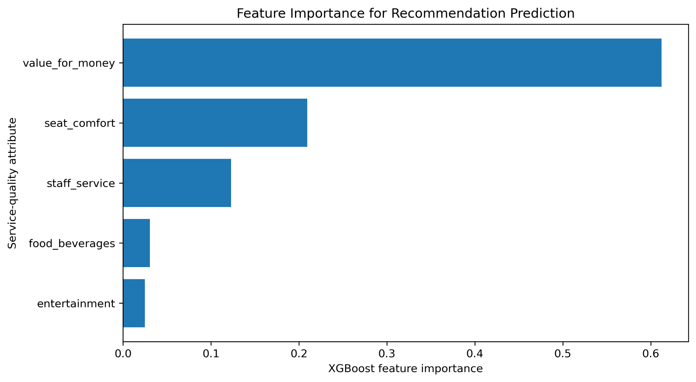

# AI-Driven Marketing Analytics: Airline Customer Satisfaction and Operational Performance

Master's thesis analysis (M.Sc. Big Data & Business Analytics, FOM University of Applied Sciences, Essen, 2026).

How do service quality and customer sentiment drive whether airline passengers recommend an airline, and how do carriers compare on operational KPIs? The analysis combines **7,555 customer reviews** of five international airlines with **570,550 U.S. flight records** from the Bureau of Transportation Statistics (BTS).

## Key results

| Model | Accuracy | F1 | ROC AUC | Misclassifications |
|---|---|---|---|---|
| Structured service ratings only | 91.6% | 0.90 | 0.97 | 127 |
| **AI-enhanced (ratings + sentiment + text)** | **93.3%** | **0.92** | **0.98** | **101** |

- Adding **VADER sentiment and TF-IDF text features** improved every metric and cut misclassifications by about 20% versus the structured-only model; repeated stratified cross-validation confirmed the result was stable.
- **Value for money** is the strongest driver of recommendation (XGBoost importance 0.61), followed by seat comfort and staff service.
- **Operational KPIs:** arrival-delay rate and average delay per carrier for 14 U.S. carriers in November 2025 (overall arrival-delay rate 20.6%).

## Methods

Python · pandas · scikit-learn · XGBoost · NLTK (VADER) · TF-IDF · Matplotlib

- Data validation and cleaning: duplicate reviews removed, missing values checked, dates validated, results documented in `validation/`
- Fixed stratified 80/20 split used for all model comparisons, plus repeated stratified 5-fold cross-validation
- Logistic Regression, Random Forest and XGBoost on structured service ratings, then an enhanced model with sentiment and text features
- Temporal analysis of recommendation rates (2015–2026) and airline-level summaries
- Independent analysis of BTS on-time performance data (delay rate, average arrival and departure delay, flight volume)

## Repository contents

| Path | Description |
|---|---|
| `Airline_Satisfaction_Analysis.ipynb` | Executed analysis notebook |
| `outputs/` | Result tables (CSV) and figures (PNG) |
| `validation/` | Data validation summaries for both datasets |
| `requirements.txt` | Package versions used |

## Data

The raw data files are not included. The review dataset was collected from public airline review pages, and the flight data is the BTS *Reporting Carrier On-Time Performance* table for November 2025 (available from BTS TranStats). To re-run the notebook, place the files in a `data/` folder as `final_airline_reviews.csv` and `BTS November 2025.csv`.

## Author

**Teja Manjusree Koduru** · M.Sc. Big Data & Business Analytics, FOM Essen · [LinkedIn](https://www.linkedin.com/in/teja-manjusree-25856b138)
